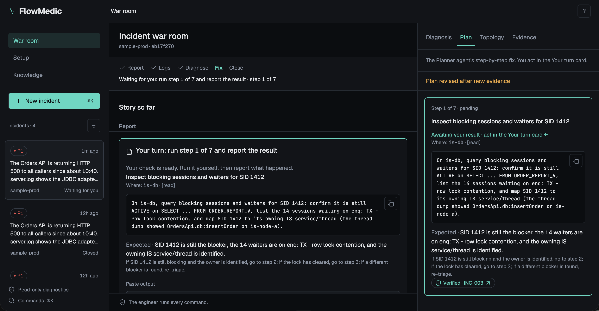
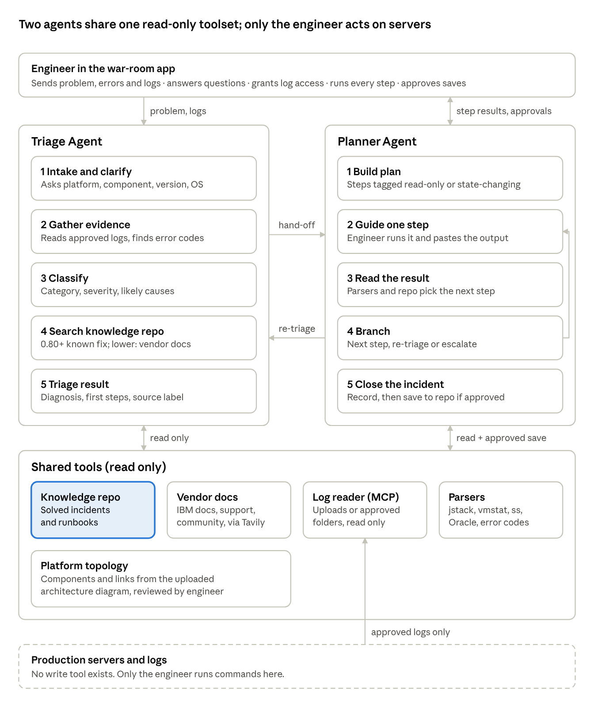
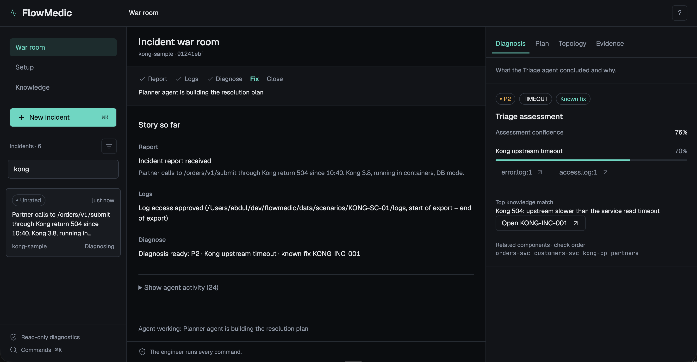
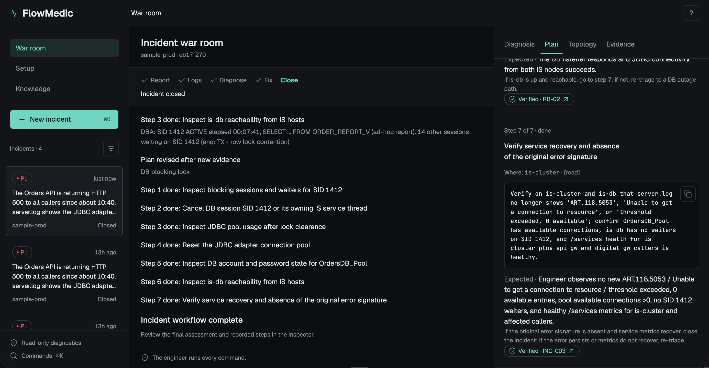
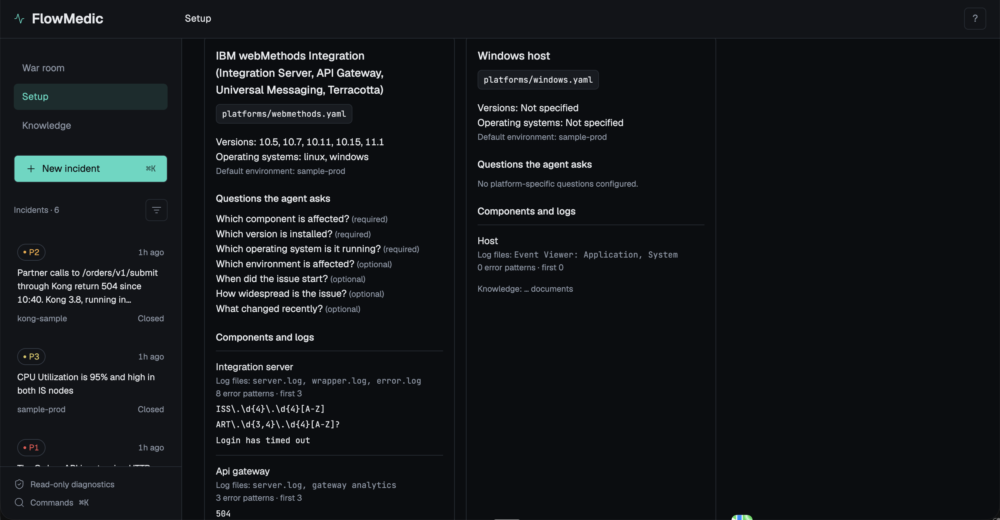
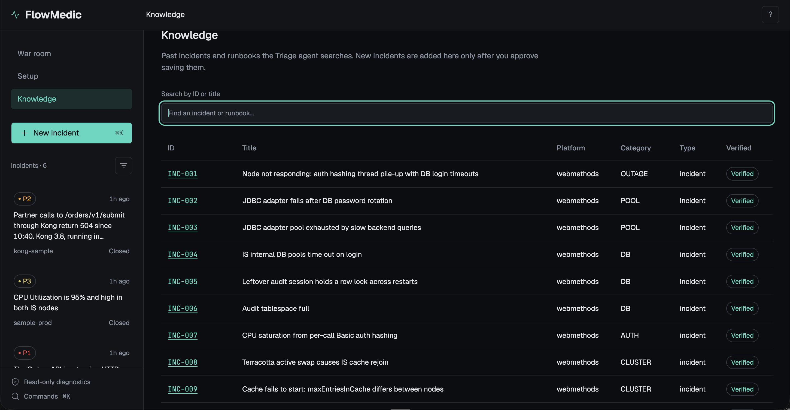

# FlowMedic: Integration Platform Triage Agent

**Diagnose the break. Guide the fix.** A read-only, two-agent assistant that helps integration engineers triage and resolve incidents on webMethods and Kong. It reads only the logs you approve, finds the known fix or researches vendor docs, and walks you through a step-by-step plan. You run every command.

**Demo video:** [Loom (5 min)](https://www.loom.com/share/714f8f00b9d24d228f1d0936be397cf5) · **Project documentation:** [Google Doc](https://docs.google.com/document/d/103zvemFp-Yqcjh2bgLJLrotx7IFX4Pby2Fhm0zChd-Y/edit)



## What it does

- **Triages an incident** from a problem report and logs: category, severity (P1–P4), likely root causes with log-line evidence, and a confidence score.
- **Finds the fix:** matches solved incidents and runbooks in a knowledge base; for new issues it researches IBM or Kong documentation and cites every step.
- **Checks dependencies first:** uses the environment topology (gateways, IS cluster, Terracotta, messaging, internal DB) before suggesting a restart.
- **Guides the engineer step by step:** each step has a command, expected result, risk and rollback. You paste the result; the plan adapts or goes back to triage when the evidence changes.
- **Learns, with approval:** a resolved incident is saved to the knowledge base only after you approve it.

## How it works



1. **Report.** The engineer describes the incident or loads a demo scenario.
2. **Logs.** The Triage agent asks for read-only access to a log folder and time window. Nothing is read without approval.
3. **Diagnose.** It masks secrets, extracts error signatures, classifies the issue and searches the knowledge base (known fix, similar, new issue, or ask for more detail).
4. **Hand-off.** The Triage agent hands the diagnosis to the Planner agent, which builds a step-by-step plan.
5. **Fix.** The engineer runs each step and reports the result in the **Your turn** card. New evidence can send the case back to triage.
6. **Close.** The incident record is shown for review and saved only if the engineer approves.

**Safety by design:** no tool can write to a server or log. Log access, every state-changing step and every knowledge save need human approval. Secrets are masked before any model sees them, and instruction-like text inside logs is quarantined, not obeyed.

## Screenshots

| | |
| --- | --- |
|  **Kong 504:** P2 · TIMEOUT · known fix, with log citations |  **Closed incident:** plain-English story of every step |
|  **Setup:** platforms, questions the agent asks, log patterns, source files |  **Knowledge:** solved incidents and runbooks the agent searches |

## Tech stack

| Component | Role |
| --- | --- |
| LangGraph | Parent graph with Triage and Planner subgraphs, hand-offs, human-in-the-loop interrupts, SQLite checkpoints |
| LangChain | Model clients, structured output, fallbacks |
| LangSmith | Tracing per incident (case, prompt and agent version) and evaluation |
| Pinecone | Knowledge base with hosted `multilingual-e5-large` embeddings, plus error-signature matching (hybrid search); Chroma as a local option |
| FastMCP | Read-only log reader as an MCP server (allowlisted folders, masking, injection quarantine) |
| Tavily | Vendor-doc research limited to trusted IBM and Kong domains |
| FastAPI | HTTP API with server-sent events for live agent progress |
| React + Vite + TypeScript | War-room UI with shadcn/ui, Motion and Lucide, designed from [DESIGN.md](DESIGN.md) with the Impeccable skill |
| uv, pytest, Playwright | Python environment, offline tests with fake models, browser tests against a fake API |

## Models

All models run on Nebius Token Factory (OpenAI-compatible). Each role's provider and model is a setting in `.env`, so Anthropic or OpenAI can be swapped in.

| Role | Model | Used for |
| --- | --- | --- |
| Fast | Qwen3-30B-A3B-Instruct-2507 | Extracting context, interpreting step results |
| Strong | DeepSeek-V4.1-Flash | Classification and planning |
| Alt | GLM-5.3 | Fallback when the strong model fails or times out |

## Knowledge and data

All data is synthetic or anonymized: fake hostnames, private IP ranges, no real names or credentials.

- **Knowledge base:** 16 solved incidents and 14 runbooks written from real field patterns, checked against IBM documentation.
- **Controlled vocabularies:** 12 issue categories and 22 root-cause IDs, so results can be scored.
- **Platforms:** webMethods, Kong, Oracle, Linux, Windows profiles (components, log files, error patterns, questions to ask).
- **Environments:** an anonymized production-style webMethods topology and a Kong sample.
- **Demo scenarios:** 12 cases with logs and expected labels, including a multi-cause outage, a new issue, a prompt-injection case and two Kong cases.

## Quick start

**Prerequisites:** [uv](https://docs.astral.sh/uv/getting-started/installation/) (installs Python 3.11), Node.js 20.19+ or 22.12+, and API keys for Nebius Token Factory and Pinecone. Tavily (vendor research) and LangSmith (tracing) are optional.

```bash
git clone https://github.com/AbdulKader-devs90/flowmedic.git
cd flowmedic
uv sync
cp .env.example .env          # Windows PowerShell: Copy-Item .env.example .env
```

Edit `.env`: set `NEBIUS_API_KEY`, `NEBIUS_BASE_URL`, the three role providers and models, and `PINECONE_API_KEY`. Then check the models and build the knowledge index:

```bash
uv run python -m flowmedic.smoke                 # each role replies with its latency
uv run python -m flowmedic.knowledge.ingest      # one-time Pinecone index build
```

**Run the web app** (two terminals):

```bash
uv run flowmedic-api                             # API on http://127.0.0.1:8000
npm --prefix app/web ci && npm --prefix app/web run dev
```

Open http://localhost:5173 and pick a demo scenario such as **SC-001**.

**Or run an incident from the terminal** with a scripted engineer:

```bash
uv run python -m flowmedic.run SC-001 --auto
```

**Tests** (offline, no API keys needed):

```bash
uv run pytest
npm --prefix app/web test                        # browser tests; needs the dev server running
```

## Project structure

```text
flowmedic/       Agents (triage, planner), graph, tools, knowledge search, API, CLI
mcp_servers/     Read-only log reader (MCP)
app/web/         React war-room UI
knowledge/       Solved incidents, runbooks, categories and root-cause IDs
platforms/       Platform profiles (webMethods, Kong, ...)
environments/    Topologies and architecture diagrams
data/scenarios/  Demo and test scenarios with logs and expected labels
tests/           Offline Python tests
docs/            Architecture, screenshots, build prompts, reference docs
```

## Results

- **Retrieval routing:** 11/11 routes and 9/9 top documents correct on the development scenarios after calibration (tuned on the same set; the Week 4 golden dataset tests generalization).
- **End-to-end demos on live models:** known fix (SC-001, re-planned when a blocking DB session appeared), new issue with cited vendor steps (SC-007), multi-cause outage (SC-008), prompt injection quarantined (SC-009), and Kong (KONG-SC-01).
- **Tests:** 126 Python tests and 9 browser tests, all offline.

## Known limitations

- A low-evidence report (for example "CPU is high", no logs) escalates without a diagnostic plan, even when the knowledge base has a related incident.
- Some plan steps come from a runbook the evidence does not call for.
- A slow model call can pause the planner for over a minute between steps.
- Tested mainly on macOS; Windows support is designed in but less exercised.

## More documentation

- [Technical reference](docs/REFERENCE.md): configuration, retrieval tuning, CLI options, API endpoints
- [Configure FlowMedic](docs/CONFIGURE.md): add a platform or an environment
- [Design spec](DESIGN.md) and [product notes](PRODUCT.md)
- [Build prompts](docs/prompts/) and [vibe coding log](docs/vibe_coding_log.md): how the project was built with Claude and Codex

## Course note

Week 3 project, Mastering Agentic AI (The Gen Academy).
