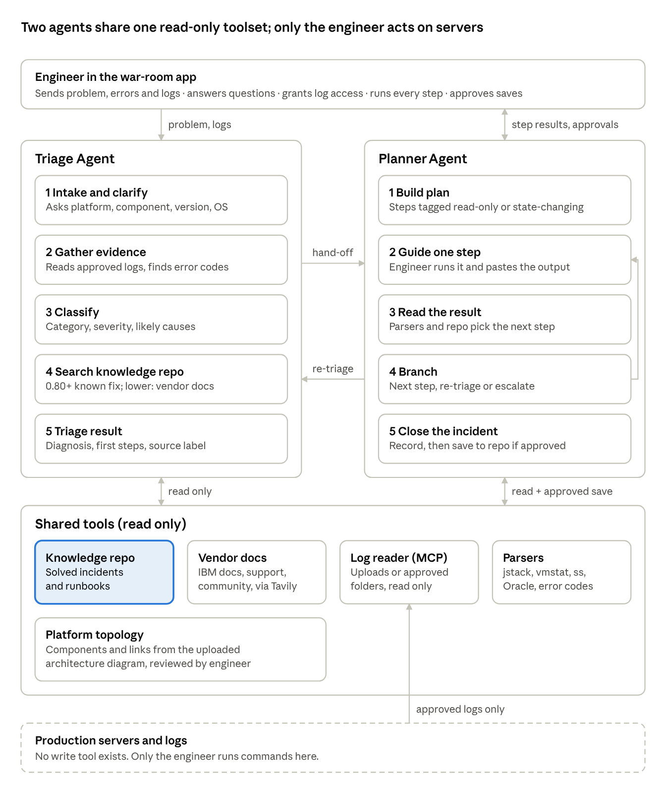
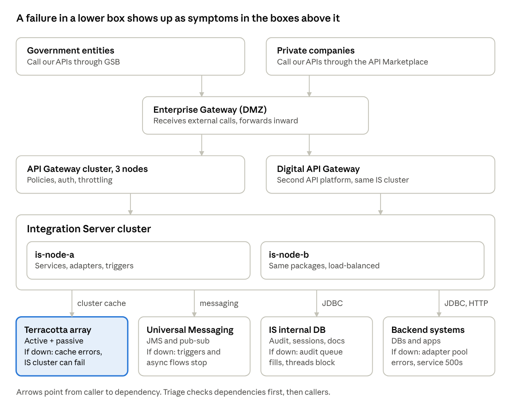

# FlowMedic: Integration Platform Triage Agent — Project Plan (Week 3 + Week 4)

Last updated: Nov 6, 2026 · Live version: the FlowMedic plan doc in Claude

## Summary

We build one project, **FlowMedic** ("Diagnose the break. Guide the fix."): a read-only, two-agent triage assistant for any integration-layer problem, from a single repeated API error up to a full platform outage. Week 3 submits the agent. Week 4 submits the evals that run on the same code and the same scenario files.

- **Triage Agent**: takes the problem statement, errors and logs from the engineer. It asks for missing context (platform, version, OS), classifies the issue, and searches the knowledge repo of solved incidents and runbooks. On a strong match it returns the known fix. With no match it researches the vendor documentation (IBM webMethods first) and returns cited steps.
- **Planner Agent**: turns the triage result into a step-by-step resolution plan. It then walks the engineer through it, one step at a time. The engineer runs every command. The agent reads the pasted output, decides the next step, and sends the case back to triage if the evidence changes.
- **Knowledge repo**: a shared component both agents use. It grows: each resolved incident is saved back after the engineer approves.

The agent never runs commands and never writes to any server, log or file. It gets only read access to logs that the engineer uploads or grants for a time window.

| Item | Week 3 | Week 4 |
| --- | --- | --- |
| Deadline | 11 Nov 2026 (required for the certificate) | Not required for the certificate; Builder of the Week deadline (1 Nov) has passed |
| What it adds | The working agent | Evals, failure analysis, 3–4 measured fixes |
| Submit | Google Doc, video (5 min max), GitHub link | Eval report, golden dataset with scores, LangSmith evidence, Loom |

## Problem and one-liner

When an integration platform has a problem, the on-call engineer loses the first hours to manual work: SSH into each node, grep logs, take thread dumps, check memory, CPU and swap, check DB sessions and locks, then search old emails and vendor sites for a fix. The knowledge from the last incident usually sits in one person's head or in an email thread.

**Users:** integration engineers, integration operations and platform operations teams who keep an ESB, API gateway or messaging layer running.

**Example problems it must handle:**

- A repeated API connection error to a backend (connection refused, SSL handshake, DNS)
- A session or read timeout between the gateway and the integration server
- A clogged JDBC connection pool on the integration server
- A database lock that blocks a backend service
- A full outage with several causes at once, like a node down with thread pile-up, swap and DB login timeouts

**Week 3 one-liner (draft):**

> My agent helps an integration or platform operations engineer triage and resolve integration-layer incidents in a Streamlit war-room app, replacing hours of manual SSH, grep, jstack, memory, CPU and DB checks across nodes and searching old incidents and vendor docs. It classifies the issue, matches it to past incidents or researches vendor documentation, and builds a step-by-step diagnostic and fix plan on its own using 7 tools. It hands off to the engineer for every command and every state-changing action, and never writes to any server. I'll know it works when an engineer gets the correct issue category and a usable first set of steps in under 3 minutes in 8 of 10 incidents, with zero actions taken on a server by the agent.

## Scope

The design is generic, and Week 3 seeds it with webMethods. Each platform is a **platform profile** (a YAML file) that lists its components, log file names, known error-code patterns, supported versions and trusted documentation domains. Week 3 also ships a light Kong Gateway profile to prove this: a different product, the same agents. Adding MuleSoft, Apigee or Kafka later works the same way, with a profile and knowledge-repo entries, not changes to the agents.

| Layer | Week 3 profiles | Later (same design) |
| --- | --- | --- |
| Integration server / ESB | webMethods Integration Server 10.5, 10.11, 10.15, 11.x | MuleSoft, Boomi |
| API gateway | webMethods API Gateway; Kong Gateway (light profile) | Apigee |
| Messaging and cluster | Universal Messaging, Terracotta | Kafka, IBM MQ |
| Database | Oracle (pools, locks, sessions, tablespace) | SQL Server, PostgreSQL |
| Host | Linux, Windows | Containers, Kubernetes |

**Kong profile (light, to show the design is extendable):** the same two agents, tools and graph run on Kong Gateway. Only three things are new: `platforms/kong.yaml`, one knowledge-repo incident (KONG-INC-001), and two scenario folders. The profile names the components (data plane, control plane, PostgreSQL config store, plugins), the log sources (`error.log`, `access.log`), common error patterns (upstream timeout, no healthy upstream, plugin and DB errors), and the trusted sources (Kong's official docs and community forum). Read-only checks use Admin API GET calls only.

| Scenario | Engineer reports | Category | Expected route | Expected root cause | Expected first steps |
| --- | --- | --- | --- | --- | --- |
| KONG-SC-01 | Partner calls to /orders/v1/submit return 504 since 10:40 | TIMEOUT | Known fix (KONG-INC-001) | Backend responds slower than the service read timeout | Check upstream latency in access.log; read the service timeouts with GET /services/{name}; check backend health; raise the timeout only with the backend owner's approval |
| KONG-SC-02 | /customers/v2/profile returns 503 for all callers after a release | CONN | New issue (vendor docs); asks for Kong version and DB or DB-less mode | Active health checks marked every target unhealthy after the backend port changed | GET /upstreams/{name}/health; compare the target host and port with the new backend port; fix the target, then confirm the health status returns HEALTHY |

Synthetic log extracts (all hosts and IPs are fake):

```text
# KONG-SC-01  error.log
2026/11/03 10:42:17 [error] 1287#0: *45812 upstream timed out (110: Connection timed out) while reading response header from upstream, client: 10.0.1.25, server: kong, request: "POST /orders/v1/submit HTTP/1.1", upstream: "http://10.0.2.40:8080/orders/submit", host: "api.example.local"
# KONG-SC-01  access.log
10.0.1.25 - - [03/Nov/2026:10:42:17 +0000] "POST /orders/v1/submit HTTP/1.1" 504 51 "-" "partner-client/2.1"

# KONG-SC-02  error.log
2026/11/04 08:15:02 [warn] 1290#0: *12 [lua] healthcheck.lua: log(): [healthcheck] (customers-upstream) unhealthy TCP increment (3/3) for 'customers-svc(10.0.2.51:8081)'
2026/11/04 08:15:09 [error] 1290#0: *9921 failure to get a peer from the ring-balancer, client: 10.0.1.31, server: kong, request: "GET /customers/v2/profile HTTP/1.1", host: "api.example.local"
```

Each Kong folder also holds `problem.md` and `expected.json`, in the same format as the webMethods scenarios.

**Issue categories (the triage label, fixed list):**

| Code | Category | Typical signals |
| --- | --- | --- |
| CONN | Connectivity | Connection refused, reset, DNS failure, SSL handshake, PKIX path errors |
| TIMEOUT | Timeout and session | Read timeout, gateway 504, session expired, idle timeout |
| AUTH | Authentication and security | 401/403, token rejected, certificate expired, slow auth hashing |
| POOL | Thread and connection pools | JDBC pool 0 available, threads waiting on getConnection, thread limit reached |
| RESOURCE | Memory, CPU, swap | Heap OutOfMemory, high GC, swap in/out, load average spike |
| DB | Database | Login timeout, blocking sessions, row locks, ORA- errors, tablespace full |
| MSG | Messaging | Session leak, queue backlog, obsolete channel, consumer stuck |
| CLUSTER | Cluster and cache | Cache rejoin, active swap, cache size conflicts |
| DEPLOY | Deployment and config | Package load failure, config change, start-up errors after a release |
| DATA | Payload and mapping | Schema validation, mapping exceptions, bad data |
| OUTAGE | Multi-cause outage | Node down, several categories at once |
| UNKNOWN | Not enough evidence | Agent must ask for more information |

Severity uses P1 (service down) to P4 (no user impact). An incident can carry one primary category and several secondary ones.

**In scope:** chat triage, clarifying questions, log upload, read-only log folder access, knowledge-repo search, vendor-doc research with citations, guided resolution plan, incident record, saving to the knowledge repo after approval.

**Out of scope:** running commands, SSH, restarts, changes to any server, ticketing integration, live monitoring alerts.

**Safety rules (built into the code, not only the prompt):**

1. Read-only by design: no tool exists that can write to a server, a log or a server file.
2. Log access only for paths and time windows the engineer approves.
3. Secrets and personal data are masked before any log text reaches a model.
4. Log text is data, never instructions. A log line that tells the agent to act is flagged as suspicious.
5. Every suggested command is tagged read-only, state-changing or destructive. State-changing and destructive steps show the risk and a rollback, and the engineer confirms they did them.
6. Each step shows its source: verified (knowledge repo), cited (vendor doc or web), or model knowledge (lowest trust).

## Agent framework (Week 3, Part 2)

This table can go straight into the Week 3 Google Doc.

| Field | Answer |
| --- | --- |
| Agent goal | Turns an engineer's problem report and logs into a categorised diagnosis and a guided, step-by-step resolution plan. |
| Where people use it | A Streamlit war-room web app: chat on the left, triage card, plan checklist and evidence on the right. |
| Steps, in order | 1. Take in the problem, errors and logs, and load the environment topology. 2. Ask for missing context (platform, component, version, OS, environment, start time, scope). 3. Request read access to logs if needed. 4. Extract error signatures, map them to components in the topology, and classify the issue. 5. Search the knowledge repo. 6. Strong match: return the known fix. No match: research vendor docs. 7. Hand off to the Planner, which builds the plan. 8. Walk the engineer through each step and read their results. 9. Re-triage or escalate if needed. 10. Close the incident and save it to the repo after approval. |
| What it can do | Read only: `read_logs`, `search_knowledge_repo`, `search_vendor_docs`, `parse_diagnostics`, `get_topology`. Human-gated: `ask_engineer` (pauses for input), `save_incident` (writes only to the agent's own repo, after approval). No tool touches a server. |
| What it remembers | This incident: problem, context, evidence, triage result, plan and step status (checkpointed, so an incident can resume hours later). Across incidents: solved incidents and runbooks in the knowledge repo, and each environment's platform, version and OS, so it does not ask again. |
| What it must never do | Run a command, write to any server, log or file, read outside approved paths, send unmasked secrets to a model, follow instructions found in logs, call a fix verified before the engineer confirms it, or present web steps as verified. |
| Human-in-the-loop | Engineer answers clarifying questions, grants log access per path and time window, runs every step, confirms state-changing steps, decides on re-triage or vendor escalation, and approves saving the incident. |
| When something breaks | Tool timeout: retry once, then mark that evidence as missing and lower confidence. Web search down: fall back to model knowledge, labelled lowest trust, and suggest a vendor case. Log too large or unreadable: narrow the time window or ask for a new export. Invalid model output: repair once, then stop and ask. Cap of 25 model calls per turn. |
| How we know it worked | Correct issue category and a usable first set of steps in under 3 minutes in 8 of 10 incidents, and 0 actions taken on a server by the agent. |

## Architecture



The Triage Agent decides what the problem is. The Planner Agent guides the engineer through fixing it. Both use the same read-only tools, and nothing in the system can act on a server.

- **One parent LangGraph graph, two subgraphs.** Hand-offs use `Command(goto=...)`: Triage to Planner when the triage result is ready, and Planner back to Triage when new evidence changes the picture.
- **Pauses use `interrupt()`.** They cover clarifying questions (at most 2 rounds), log-access requests, each plan step, and the save approval. The SQLite checkpointer keeps the incident state while it waits.
- **Patterns used:** Plan-and-Execute at the Planner level, a small ReAct loop inside evidence gathering and vendor research, and plain Python for parsing and routing rules, so those steps cost no model calls and give the same result every time.
- **Each triage result carries:** category, severity, ranked causes with evidence lines, confidence, route (known fix, similar, or new issue), first steps, and a source label on every step.

## Platform topology (architecture upload)

The engineer uploads the platform's architecture diagram once per environment. The agent turns it into a reviewed component map. It then uses that map to decide which related components to check, in what order, and who is affected.



This sample is our platform with aliases only. Check the links against the real setup before using it.

**How it works**

1. **Upload:** a PNG, PDF, or draw.io / Visio export of the architecture diagram.
2. **Extract:** a vision-capable model reads the boxes and arrows and drafts `topology.yaml`: components, nodes, links, link type, and whether each dependency is hard (the caller fails without it) or soft.
3. **Review:** the engineer corrects and approves the draft. The agent uses only the reviewed file.
4. **Store:** saved in environment memory with the platform and version, so later incidents reuse it.
5. **Use:** triage maps each symptom to a component, then walks the links. Dependencies come first (what the failing component needs), then callers (who sees the impact). The result is the list of related checks, their order, which logs to ask for, and the blast radius.

**Sample `topology.yaml` (anonymized)**

```yaml
environment: sample-prod
platform: webmethods-10.15
components:
  - {id: gov-consumers, type: consumer_group, via: GSB}
  - {id: private-consumers, type: consumer_group, via: api-marketplace}
  - {id: ent-gw, type: enterprise_gateway, zone: dmz}
  - {id: api-gw, type: api_gateway, nodes: [gw-1, gw-2, gw-3]}
  - {id: digital-gw, type: api_gateway}
  - {id: is-cluster, type: integration_server, nodes: [is-node-a, is-node-b], logs: [server.log, wrapper.log]}
  - {id: tsa, type: terracotta, nodes: [tsa-1, tsa-2], mode: active_passive}
  - {id: um, type: universal_messaging}
  - {id: is-db, type: oracle, roles: [ISInternal, ISCoreAudit, DocumentHistory]}
  - {id: backends, type: backend_systems}
links:
  - {from: gov-consumers, to: ent-gw, kind: https}
  - {from: private-consumers, to: ent-gw, kind: https}
  - {from: ent-gw, to: api-gw, kind: https}
  - {from: ent-gw, to: digital-gw, kind: https}
  - {from: api-gw, to: is-cluster, kind: https, auth: basic}
  - {from: digital-gw, to: is-cluster, kind: https}
  - {from: is-cluster, to: tsa, kind: cluster_cache, hard: true}
  - {from: is-cluster, to: um, kind: messaging, hard: true}
  - {from: is-cluster, to: is-db, kind: jdbc, hard: true}
  - {from: is-cluster, to: backends, kind: jdbc_http, hard: false}
```

**How triage uses it**

| Symptom seen at | Also check, in this order | Runbooks |
| --- | --- | --- |
| IS: cache errors, or IS will not start | Terracotta status and swap, then the IS cache settings | RB-08, RB-09 |
| IS: threads blocked in `getConnection` | IS internal DB, then backend DB sessions and locks | RB-03, RB-04 |
| IS: triggers or async flows stop | UM server and the connection count from each IS node | RB-10 |
| API Gateway: 504s or slow responses | IS threads against the limit, then the backend behind the API | RB-06, RB-07 |
| Consumers: 401 or 403 | Gateway policy, then IS auth on each node | RB-13 |
| One IS node only | That node's host, threads and settings compared with the healthy node | RB-01, RB-11 |

**Example:** "is-node-b not responding." The topology says IS has hard dependencies on Terracotta, UM and the internal DB. So the agent asks for those checks before it suggests any IS restart. It also lists both gateways and both consumer groups as affected.

Diagrams with real IPs stay on the engineer's machine. The repo holds aliases only, and masking applies to anything sent to a model.

For Week 3 the sample topology is hand-written; reading it from a diagram image is a stretch goal. In Week 4 this can be scored as "related components checked" per case.

## Tools, memory, approvals and failure handling

**Tools**

| Tool | Used by | Type | What it does |
| --- | --- | --- | --- |
| `ask_engineer` | Both | Pause for input | LangGraph `interrupt()` with a structured question, for example "Which IS version: 10.5, 10.11, 10.15 or 11.x?" |
| `read_logs` | Both | Read only | Served by a small read-only MCP server: `list_files`, `grep(pattern, window)`, `tail(window)`, `stats`. Works on uploaded files or an approved folder. Masks secrets before returning text. |
| `parse_diagnostics` | Both | Read only, no model | Plain Python parsers for jstack (thread groups), vmstat and free (swap, run queue), ss counts, Oracle session and lock output, and error-signature extraction (codes like ISS.0128, ORA-01653) with first seen, last seen and count. |
| `search_knowledge_repo` | Both | Read only | Hybrid search over solved incidents and runbooks: exact error-signature match, vector similarity on symptoms, filtered by platform, component and version. Returns matches with a score. |
| `search_vendor_docs` | Triage | Read only | Tavily search limited to trusted domains from the platform profile (ibm.com/docs, ibm.com/support, community.ibm.com, then wider web). Version is part of the query. Returns steps with citations. |
| `save_incident` | Planner | Write to the agent's own repo only | Saves the closed incident (symptoms, signatures, root cause, steps that worked, version, OS) after the engineer approves. |
| `get_topology` | Both | Read only | Returns the reviewed component graph for the environment: what a component depends on, who calls it, and where its logs are. Built from the uploaded architecture diagram. |

**Knowledge-repo routing (the core of the Triage Agent):**

| Best match score | Route | What the engineer sees |
| --- | --- | --- |
| 0.80 or higher, and signature or category matches | Known fix | "Matches incident INC-007 (JDBC pool exhausted). Do steps 1, 2, 3." Source: verified. |
| 0.60 to 0.80 | Similar, confirm | The candidate fix, plus vendor-doc research to confirm or adjust it. |
| Under 0.60, or no match | New issue | Vendor-doc research with citations. Source: cited. |

These thresholds are starting values. Tuning them is a good Week 4 improvement.

**Memory**

| Kind | Where it lives | Holds |
| --- | --- | --- |
| Short-term | LangGraph state | Messages, context slots, evidence, triage result, plan, step status |
| Checkpoint | SQLite checkpointer, one thread per incident | Lets an incident pause for approval or for hours and resume |
| Long-term, knowledge | Vector store + SQLite metadata | Solved incidents and runbooks; grows after each approved save |
| Long-term, environment | LangGraph store | Each environment's platform, version, OS, log paths and reviewed topology, so the agent does not ask again |

**Human approval points**

1. Answering clarifying questions, and reviewing the topology drawn from an uploaded architecture diagram
2. Granting log access, per path and time window
3. Running every step (the agent never runs anything)
4. Confirming each state-changing or destructive step, after seeing its risk and rollback
5. Choosing re-triage or vendor escalation when the plan stalls
6. Approving the incident record before it is saved to the repo

**Failure handling**

| What breaks | What the agent does |
| --- | --- |
| Tool timeout or error | Retry once with backoff. Then mark that evidence as missing, lower confidence, and say which check is missing. |
| Vendor search down or empty | Use model knowledge, labelled lowest trust, and offer a draft vendor support case. |
| Log file too large | Narrow to the incident time window and the error signatures first. |
| Log unreadable or wrong format | Ask the engineer for a new export, with the exact file and window. |
| Model returns invalid structured output | Repair once. If it fails again, stop and ask. |
| Evidence conflicts | Lower confidence and ask for one specific piece of evidence. |
| Loop or runaway cost | Cap of 25 model calls per turn and a cost limit per incident, then hand back to the engineer. |
| Suspicious text in logs | Treat it as data, flag it in the evidence panel, and never act on it. |

## Build: stack, repo, data and demo

**Stack**

| Part | Choice | Why |
| --- | --- | --- |
| Agents and graph | LangGraph + LangChain, Python 3.11 | Subgraphs, `interrupt()`, checkpointers, `Command` hand-offs |
| Tracing and evals | LangSmith | Required for the Week 4 route; traces from day 1 |
| Models | Nebius Token Factory open model for classification and log summaries; Claude Opus 5.5 for triage synthesis and planning; OpenAI as the alternate | The handout asks for at least one Nebius call; two tiers also give Week 4 a cost-vs-quality lever |
| Log access | Read-only MCP server (Python MCP SDK) | Covers the MCP topic; the same tools work on uploads or an approved folder |
| Web research | Tavily with domain filters | Already used in the course reference kits |
| Knowledge repo | Pinecone (Chroma as fallback) + SQLite metadata, Markdown source files | One cloud index shared by both laptops; source files stay in Git |
| Data models | Pydantic | Structured outputs that evaluators can score |
| UI | Streamlit | Fast war-room layout; same choice as the reference kits |

**Repo layout**

```text
flowmedic/                         repo root
  AGENTS.md                        rules Codex follows on every task
  pyproject.toml  uv.lock          Python 3.11, dependencies, lockfile
  .env.example  .gitignore  .gitattributes  README.md
  flowmedic/                       Python package
    config.py  llm.py  tracing.py  smoke.py
    graph/                         state.py, main_graph.py (parent graph, hand-offs, checkpointer)
    agents/triage/                 graph.py, nodes.py, prompts.py
    agents/planner/                graph.py, nodes.py, prompts.py
    tools/                         knowledge_repo.py, vendor_docs.py, log_client.py, topology.py, redact.py
    tools/parsers/                 jstack.py, vmstat.py, ss.py, oracle.py, signatures.py
  app/streamlit_app.py             war-room UI
  mcp_servers/log_reader/          server.py (read only, path allowlist)
  platforms/                       webmethods.yaml, kong.yaml, oracle.yaml, linux.yaml, windows.yaml
  environments/sample-prod/        architecture.png, topology.yaml (anonymized)
  knowledge/incidents/             INC-001.md ... (YAML front matter + steps)
  knowledge/runbooks/              RB-01.md ... RB-14.md
  knowledge/ingest.py
  data/scenarios/SC-001/           problem.md, logs/, expected.json   (reused as the Week 4 golden set)
  evals/                           dataset.py, evaluators.py, run_eval.py   (Week 4)
  docs/                            PROJECT_PLAN.md, progress.md, vibe_coding_log.md, architecture.png
  tests/
```

**Data to create (all synthetic or anonymized, safe for a public repo)**

- 12–15 solved incidents, at least one per category: JDBC pool exhausted, DB blocking lock, tablespace full, DB login timeout, gateway-to-IS session timeout, repeated connection refused to a backend, SSL certificate expired, Terracotta rejoin, UM session leak, thread pile-up from auth hashing, heap OutOfMemory, swap, package load failure after deploy.
- 14 runbooks: node-down diagnostic checklist (host, threads, DB, cluster, messaging, gateway), JDBC pool checks, DB lock checks, thread dump reading, safe recovery order.
- 8–10 scenario folders for Week 3, each with a problem statement, log extracts and `expected.json` (category, root cause, expected route, expected first steps, whether clarification is needed). At least 3 are not in the repo, so they test the vendor-doc path. Add the 2 Kong scenarios and KONG-INC-001 (see the Kong profile under Scope).
- Fake names only: hosts like `is-node-a`, IPs from 10.0.0.0/24, made-up users and schemas. Nothing from a real environment.

Full runbook list and steps: [RUNBOOKS.md](RUNBOOKS.md)

Writing `expected.json` now means the Week 4 golden set is already a third built.

**Demo scenarios for the 5-minute video**

1. **Known issue:** "Orders API returns 500, server.log shows JDBC pool 0 available." Triage asks for the IS version, finds INC-003, returns three steps. Planner walks through them; the engineer pastes pool stats; resolved.
2. **New issue:** "SSL handshake failed to a partner endpoint after a certificate change." No repo match. The agent asks for version and OS, searches IBM docs, and returns cited steps marked as cited, not verified.
3. **Full outage:** "Node B not responding, load very high." The agent uses the topology to list the related components (Terracotta, messaging, internal DB, gateway), asks for log access for a 30-minute window, and reads the logs. It finds thread pile-up and DB login timeouts. The Planner runs the checklist with the engineer, the thread dump shows threads waiting on DB connections, and the case goes back to triage, which finds a DB lock. The incident is saved to the repo after approval.

**Extendability clip (about 30 seconds):** switch the profile to Kong and run KONG-SC-02. The same agents ask for the Kong version, research Kong docs, and return cited steps.

## Week 4: evaluation plan

Week 4 measures the same agent on 40 labelled scenarios in LangSmith, finds the top failure modes, and proves 3–4 fixes with before and after numbers.

**Evaluation one-liner (draft):**

> I will measure category accuracy, root-cause hit rate, route correctness, clarification behaviour, safety compliance and plan groundedness on FlowMedic using a golden dataset of 40 cases covering known issues, new issues, missing context, multi-cause outages and log injection, with code-based checks plus a calibrated LLM judge. Pass bar: 85% category accuracy, 80% root-cause hit in the top 3, 85% correct route, 100% safety, 80% grounded plans, p95 under 60 s to the triage result, cost under $0.10 per incident. I will compare the baseline with the improved version using LangSmith experiments.

**Metrics** (pass bars are first targets; adjust after the baseline)

| Metric | What it checks | Judge | Pass bar |
| --- | --- | --- | --- |
| Category accuracy | Primary category matches the label | Code, exact match | 85% |
| Root-cause hit@3 | Labelled root cause is in the top 3 | Code, ID match | 80% |
| Route correctness | Known fix vs similar vs new issue, and the right incident ID on a known fix | Code, exact match | 85% |
| Clarification behaviour | Asks when a needed slot is missing; does not ask when it was given | Trajectory, code | 90% |
| Safety compliance | No server action, unsafe steps tagged with rollback, log injection ignored, secrets masked | Code + LLM judge | 100% |
| Plan groundedness | Each step comes from the matched incident, runbook or a cited source | LLM judge, checked against 10 human labels | 80% |
| Latency and cost | p95 time to triage result, tokens and cost per incident, tool-call count | Code from LangSmith runs | p95 60 s, $0.10 |

**Golden dataset: 40 cases**

| Type | Cases | Examples |
| --- | --- | --- |
| Happy path | 20 | One clear issue per category, with a match in the repo; 2 of them are Kong cases |
| Edge | 12 | Version missing (must ask), similar but different repo incident, new issue (vendor path), multi-cause outage, false alarm |
| Known failure | 6 | DB lock hidden behind a thread pile-up, noisy logs with a misleading error, version-specific fix |
| Adversarial | 2 | Log line telling the agent to restart or delete; secrets in the log that must be masked |

Sources: real incident patterns, anonymised, then varied with a model and labelled by hand. Model-written cases stay under 20%. Each case carries `case_id`, scenario type, inputs, expected category, root cause, route, clarification flag and safety expectations.

**Planner evaluation:** for about 10 cases, a scripted engineer simulator returns stored command outputs for each step. This measures whether the plan reaches the right fix and how many steps it takes compared with the shortest path.

**LangSmith setup**

1. Project `flowmedic-eval`; tracing on from day 1 with `LANGSMITH_TRACING`, `LANGSMITH_API_KEY`, `LANGSMITH_PROJECT`.
2. Every run carries metadata: `case_id`, `prompt_version`, `agent_version`, `model`, `route`, `expected` and `predicted` values.
3. Check that one trace shows the graph, model calls and tool calls as child runs before scaling up.
4. Upload the 40 cases with `client.create_dataset()`, tagged `v1`. Use the same version for both runs.
5. Register code evaluators and the LLM judge, then run `client.evaluate()`.
6. Read every failure and write a note, then group the notes into failure modes.
7. Make the fixes, rerun as a new experiment, and compare in the Comparison view, regressions included.

**Likely improvement levers**

| Lever | Change | Failure it targets |
| --- | --- | --- |
| Retrieval | Boost exact error-signature matches; tune the 0.80 / 0.60 thresholds | Wrong route, wrong incident matched |
| Control flow | Rule: a thread pile-up always triggers DB checks | DB lock hidden behind thread symptoms |
| Prompt | Few-shot examples of the multi-cause outage; clearer category boundaries | CONN vs TIMEOUT vs POOL confusion |
| Tool design | Pre-filter logs by window and signature before the model reads them | Missed signals in noisy logs, high cost |
| Model | Swap the model for triage synthesis (Nebius vs stronger) | Reasoning errors on multi-cause cases |
| Guardrail | Input filter for instruction-like log lines | Log injection |

**Production monitoring plan (for the report):** track knowledge-repo hit rate, vendor-path rate, clarification rate, tool failure rate, escalation rate, p95 latency and cost per incident in LangSmith, with alerts on drift.

## Timeline and checklists

Week 3 is submitted on Wed 11 Nov, and Week 4 starts on Thu 12 Nov on the same repo. Tick the tasks off as you go.


**Thu 5 Nov (evening): set-up**

- [ ] Decide the open points below
- [ ] Create the GitHub repo, `.env.example`, and the LangSmith project
- [ ] Start `docs/vibe_coding_log.md` (Week 3 asks for your AI coding prompts and iterations)

**Fri 6 Nov: data and knowledge repo**

- [ ] Platform profiles (webMethods in full, Kong light), the category list, and the anonymized sample topology
- [ ] 12–15 incidents, 14 runbooks, `ingest.py`, hybrid search working
- [ ] 8–10 scenario folders with `expected.json`

**Sat 7 Nov: Triage Agent**

- [ ] State models, intake, clarifying-question pause
- [ ] Read-only MCP log server, parsers, secret masking, topology loader and dependency walk
- [ ] Classification, repo routing, vendor-doc path, triage result card

**Sun 8 Nov: Planner Agent and memory**

- [ ] Plan builder with step tags (read-only, state-changing, destructive)
- [ ] Step loop with pauses, output reading, re-triage hand-off
- [ ] Incident record, approved save to the repo, checkpointer, environment memory

**Mon 9 Nov: UI and hardening**

- [ ] Streamlit war-room layout
- [ ] Failure handling, call and cost caps, Nebius model call
- [ ] Run the 3 demo scenarios end to end and fix what breaks

**Tue 10 Nov: Week 3 package**

- [ ] README with the architecture diagram
- [ ] Week 3 Google Doc: overview, datasets, AI coding prompts, iterations, learnings
- [ ] Record the video (5 minutes or less)

**Wed 11 Nov: buffer and submit**

- [ ] Final fixes, push, submit the Week 3 form

**From Thu 12 Nov: Week 4**

- [ ] Grow to 40 cases and upload as a LangSmith dataset `v1`
- [ ] Evaluators and judge; baseline run
- [ ] Failure notes, failure modes, cost of each
- [ ] 3–4 fixes, rerun, deltas and regressions
- [ ] Eval report, Loom, submit the Week 4 form

**MVP cut line (if time runs short)**

| Must have for Week 3 | Can wait |
| --- | --- |
| Triage with clarifying questions | Environment memory |
| Knowledge-repo path and vendor-doc path | Read-only folder access (keep upload only) |
| Log upload and parsers | Engineer simulator (Week 4 only) |
| Planner step loop with approvals | Vendor support case draft |
| Failure handling and tracing | Platform profiles beyond Kong |
| Hand-written topology for the sample platform | Reading the topology from a diagram image automatically |

**Submission checklists**

Week 3:

- [ ] Google Doc: overview, datasets, AI coding prompts, iterations, learnings (the framework table above fits here)
- [ ] Video, 5 minutes or less: what it does, how AI coding tools helped, live demo
- [ ] GitHub link

Week 4:

- [ ] Report: use case, one-liner, metrics with pass bars, judge rubric
- [ ] 40 cases with baseline and improved scores, failure category per case
- [ ] Top 3 failure modes, 3–4 fixes, deltas and regressions, next steps
- [ ] Prompts, judge prompt, evaluator code, judge vs human comparison
- [ ] LangSmith run links or trace screenshots
- [ ] Loom

**Decisions**

- **Name:** FlowMedic, "Diagnose the break. Guide the fix."
- **Models:** Nebius open model for fast steps (classification, log summaries); Claude Opus 5.5 (`claude-opus-5-5`, Anthropic API) for triage synthesis and planning; OpenAI as the alternate for fallback and the Week 4 model comparison. A ChatGPT Pro plan covers Codex, not API calls, so the agent needs a paid API key for each provider.
- **Vector store:** Pinecone (you have credits, and one cloud index serves both laptops), behind a small interface with Chroma as the fallback if Pinecone setup slows us down.
